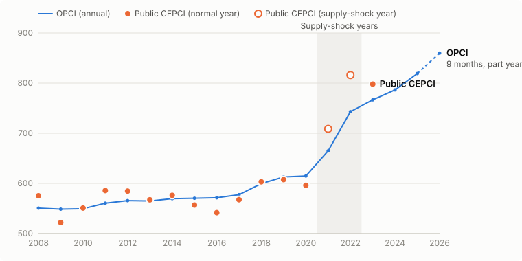

# Validation: OPCI against public CEPCI values

Open Plant Cost Index (OPCI) v1.0.0 | Maintained by ORIMIZ Consulting  
Data to 2026-09 | snapshot 2026-10-24 | investment type: general | productivity 2% | index source: open

This page compares OPCI with Chemical Engineering Plant Cost Index (CEPCI) annual averages that Chemical Engineering has published free. Each value is cited to its source. The page is rebuilt on every data refresh by `python -m opci.validate`.

## Result

- Scale fitted on 14 normal years (supply-shock years 2021 and 2022 left out). OPCI 2019 = 612.9.
- Worst error on the normal years: **5.5%** (fail limit 8%): **PASS**.
- Root mean square (RMS) error on the normal years: 3.2%.
- Worst error on the supply-shock years: 8.9% (watch limit 10%, reports only): **within watch limit**.

## Normal years (used for the scale fit)

| Year | Public CEPCI | OPCI | Difference | Source |
|---|---|---|---|---|
| 2008 | 575.4 | 550.7 | -4.3% | [Chemical Engineering, Economic Indicators, August 2014, p. 64, Annual Index (reproduced in CE media kit page)](https://www.chemengonline.com/Assets/CHE15_mk_economicindicators.pdf) |
| 2009 | 521.9 | 548.6 | +5.1% | [Chemical Engineering, Economic Indicators, August 2014, p. 64, Annual Index (reproduced in CE media kit page)](https://www.chemengonline.com/Assets/CHE15_mk_economicindicators.pdf) |
| 2010 | 550.8 | 549.5 | -0.2% | [Chemical Engineering, Economic Indicators, August 2014, p. 64, Annual Index (reproduced in CE media kit page)](https://www.chemengonline.com/Assets/CHE15_mk_economicindicators.pdf) |
| 2011 | 585.7 | 560.5 | -4.3% | [Chemical Engineering, Economic Indicators, August 2014, p. 64, Annual Index (reproduced in CE media kit page)](https://www.chemengonline.com/Assets/CHE15_mk_economicindicators.pdf) |
| 2012 | 584.6 | 565.7 | -3.2% | [Chemical Engineering, Economic Indicators, August 2014, p. 64, Annual Index (reproduced in CE media kit page)](https://www.chemengonline.com/Assets/CHE15_mk_economicindicators.pdf) |
| 2013 | 567.3 | 564.9 | -0.4% | [Chemical Engineering, Economic Indicators, August 2014, p. 64, Annual Index (reproduced in CE media kit page)](https://www.chemengonline.com/Assets/CHE15_mk_economicindicators.pdf) |
| 2014 | 576.1 | 569.6 | -1.1% | [Chemical Engineering, Economic Indicators, 2022 issue, Annual Index (third-party copy); also Towering Skills, Cost Indices](https://toweringskills.com/financial-analysis/cost-indices/) (secondary source) |
| 2015 | 556.8 | 570.4 | +2.4% | [Chemical Engineering, Chemical Engineering Plant Cost Index: 2018 Annual Value, 20 March 2019](https://www.chemengonline.com/?p=184303) |
| 2016 | 541.7 | 571.3 | +5.5% | [Chemical Engineering, Economic Indicators, September 2024, p. 45, Annual Index](https://www.chemengonline.com/wp-content/uploads/2024/08/19_CHE_0924_EconInd_p45.pdf) |
| 2017 | 567.5 | 577.6 | +1.8% | [Chemical Engineering, Economic Indicators, September 2024, p. 45, Annual Index](https://www.chemengonline.com/wp-content/uploads/2024/08/19_CHE_0924_EconInd_p45.pdf) |
| 2018 | 603.1 | 599.6 | -0.6% | [Chemical Engineering, Economic Indicators, September 2024, p. 45, Annual Index](https://www.chemengonline.com/wp-content/uploads/2024/08/19_CHE_0924_EconInd_p45.pdf) |
| 2019 | 607.5 | 612.9 | +0.9% | [Chemical Engineering, 2019 Chemical Engineering Plant Cost Index Annual Average, 20 March 2020](https://chemengonline.com/2019-chemical-engineering-plant-cost-index-annual-average) |
| 2020 | 596.2 | 614.7 | +3.1% | [Chemical Engineering, Economic Indicators, September 2024, p. 45, Annual Index](https://www.chemengonline.com/wp-content/uploads/2024/08/19_CHE_0924_EconInd_p45.pdf) |
| 2023 | 797.9 | 766.7 | -3.9% | [Chemical Engineering, 2023 CEPCI annual average value decreases from previous year, 25 March 2024](https://chemengonline.com/2023-cepci-annual-average-value-decreases-from-previous-year) |

## Supply-shock years (2021 and 2022)

In 2021 and 2022 equipment and material prices rose fast after the pandemic. CEPCI rose faster than the Bureau of Labor Statistics (BLS) series that OPCI uses, so OPCI ran below CEPCI. These years are left out of the scale fit and checked against a separate watch limit. The output warns when a base or target date falls in these years. See METHOD.md.

| Year | Public CEPCI | OPCI | Difference | Source |
|---|---|---|---|---|
| 2021 | 708.8 | 664.9 | -6.2% | [Chemical Engineering, Economic Indicators, September 2024, p. 45, Annual Index](https://www.chemengonline.com/wp-content/uploads/2024/08/19_CHE_0924_EconInd_p45.pdf) |
| 2022 | 816.0 | 743.0 | -8.9% | [Chemical Engineering, Economic Indicators, September 2024, p. 45, Annual Index](https://www.chemengonline.com/wp-content/uploads/2024/08/19_CHE_0924_EconInd_p45.pdf) |

## Productivity rate sensitivity

Same rate on labour and engineering. Scale refitted on the normal years for each rate.

| Rate | Worst error | RMS error | OPCI 2019 | OPCI latest |
|---|---|---|---|---|
| 0.0% | 10.0% | 5.3% | 638.6 | 945.3 |
| 1.0% | 7.3% | 4.0% | 626.0 | 901.7 |
| 1.5% | 5.8% | 3.5% | 619.5 | 880.6 |
| **2.0%** | 5.5% | 3.2% | 612.9 | 859.9 |
| 2.5% | 6.7% | 3.2% | 606.2 | 839.7 |

Rate fitted jointly with the scale (check only): 2.25% (worst error 5.9%, RMS 3.1%). The default stays at 2%.

OPCI latest is 2026 (9 months, part year).

## Gaps

- No public annual value found for 2024 or 2025. Chemical Engineering stopped printing the index in the magazine after August 2024.
- The 2014 value is from a secondary source. No free primary source was found.

CEPCI is a trademark of Chemical Engineering magazine. OPCI is not affiliated with or endorsed by Chemical Engineering.
